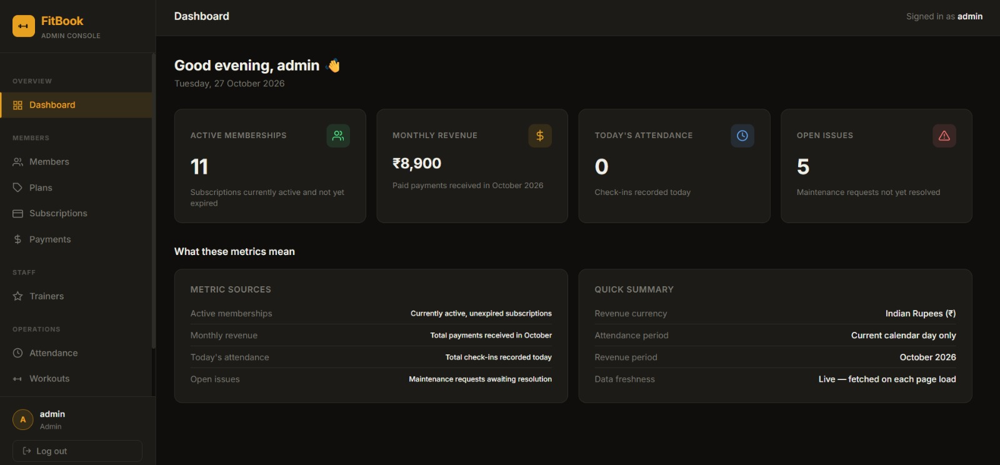
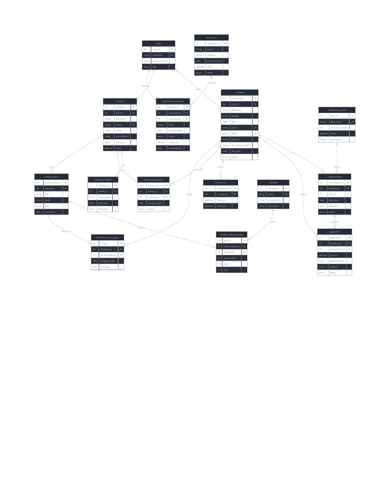
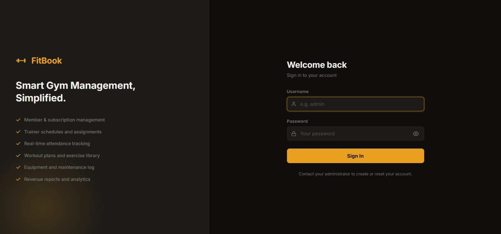
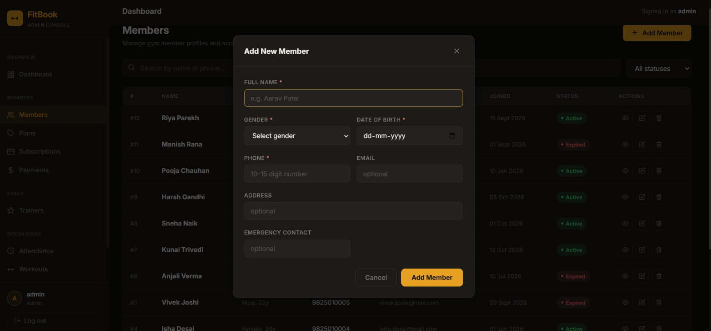
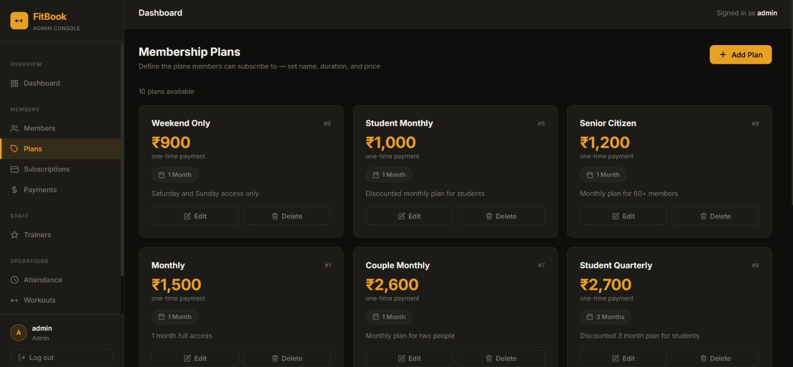
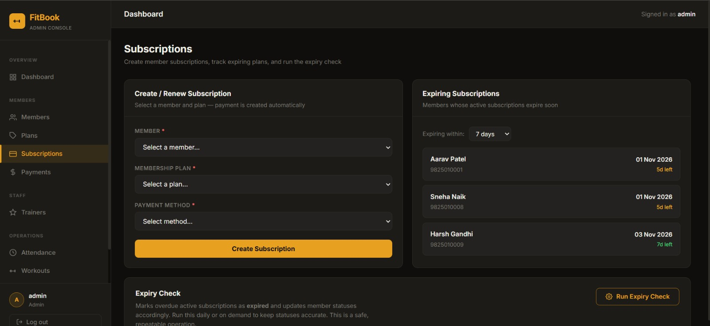
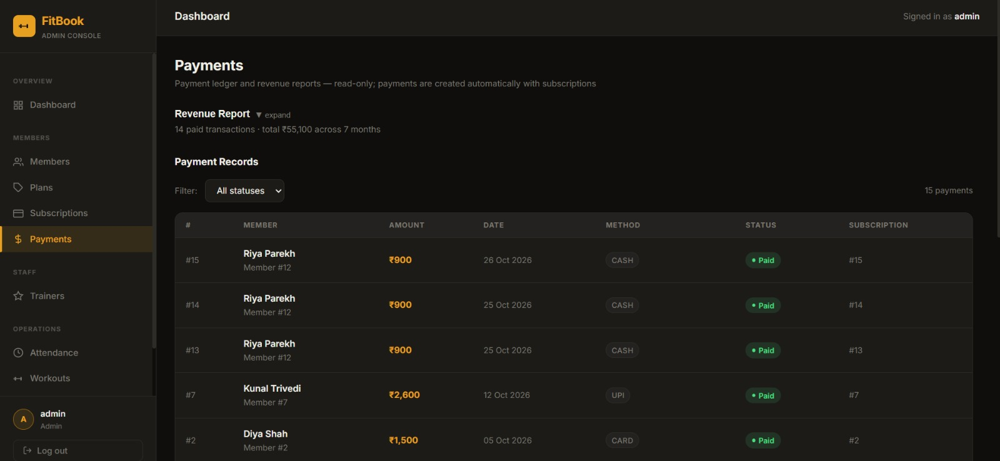
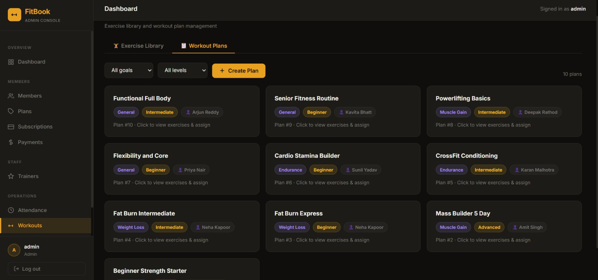
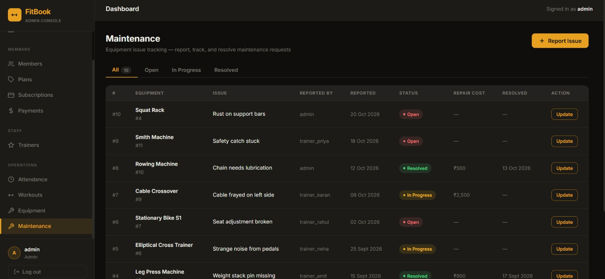

# FitBook — Smart Gym Management System

**DBMS Software Project · IA203 — Database Management Systems**  
**Department of Artificial Intelligence · SVNIT Surat · 3rd Semester, 2026–27**

FitBook is a gym-management web application that brings member profiles, membership plans, subscriptions, payments, trainer management, attendance, workout planning, equipment inventory, and maintenance requests into one system. It uses a React frontend, a Node.js/Express REST API, and a MySQL relational database, with JWT authentication and role-based access for administrators, trainers, and members.

<p align="center">
  
</p>

## Table of Contents

- [Overview](#overview)
- [Problem Statement](#problem-statement)
- [Objectives](#objectives)
- [Features](#features)
- [Technology Stack](#technology-stack)
- [System Architecture](#system-architecture)
- [ER Diagram](#er-diagram)
- [Database Design](#database-design)
- [DBMS Concepts Demonstrated](#dbms-concepts-demonstrated)
- [Project Structure](#project-structure)
- [Getting Started](#getting-started)
- [API Overview](#api-overview)
- [Security](#security)
- [Screenshots](#screenshots)
- [Testing](#testing)
- [Limitations and Future Improvements](#limitations-and-future-improvements)
- [Team / Academic Context](#team--academic-context)

## Overview

Gym operations involve many connected records: members subscribe to plans, subscriptions generate payment records, trainers work with members, attendance needs to be recorded, and equipment issues need to be resolved. FitBook models these relationships in a relational database and provides a web interface for authorised users to manage and review the information.

## Problem Statement

Maintaining gym records separately can lead to duplicated data, inconsistent membership statuses, difficulty tracking renewals and payments, and limited visibility into attendance and equipment issues. FitBook centralises these operations and uses database relationships and application rules to help keep information organised.

## Objectives

- Maintain centralised member, trainer, plan, subscription, and payment records.
- Support subscription creation, renewal, cancellation, and expiry checks.
- Record attendance check-ins/check-outs and provide attendance summaries.
- Manage trainer schedules and trainer–member assignments.
- Maintain an exercise library and workout plans that can be assigned to members.
- Track equipment inventory and maintenance requests, including resolution and repair cost.
- Demonstrate relational database design, SQL queries, constraints, joins, reporting, transactions, views, stored procedures, triggers, and indexes.

## Features

| Module | Main capabilities |
|---|---|
| Authentication and users | Username/password login, JWT-based authentication, identity lookup, password change, and administrator-managed accounts. |
| Dashboard | Summary metrics for memberships, revenue, attendance, and open maintenance issues. |
| Members | Register, search, filter, view, update, and remove member records. |
| Membership plans | Create and manage plan names, durations, prices, and descriptions. |
| Subscriptions | Create/renew subscriptions, cancel subscriptions, view upcoming expiries, and run an expiry check. |
| Payments and reports | Review payment history and revenue summaries. Only paid transactions should count as revenue. |
| Trainers and assignments | Manage trainer profiles and schedules, view clients, and maintain trainer–member assignments. |
| Attendance | Check members in/out, view current attendance, and review attendance analytics. |
| Exercises and workouts | Maintain an exercise library, create workout plans, define exercise/set/rep details, and assign plans. |
| Equipment | Maintain gym equipment inventory and equipment status. |
| Maintenance | Report issues, track status through resolution, and record repair costs. |
| Member/trainer portal | Access role-appropriate profile and activity information, subject to implemented permissions. |

## Technology Stack

| Layer | Technology |
|---|---|
| Frontend | React, Vite, JavaScript, CSS |
| Backend | Node.js, Express.js |
| Database | MySQL |
| Authentication | JSON Web Tokens (JWT), password hashing with bcrypt where configured |
| Request validation | Zod where configured in the API |
| API communication | REST endpoints with JSON responses |
| API documentation/testing | Swagger/OpenAPI and a Postman collection where included in the repository |
| Development tools | Git, GitHub, npm, Visual Studio Code |

## System Architecture

FitBook follows a client–server architecture:

```text
User
  |
  v
React + Vite frontend
  |  HTTP requests / JSON
  v
Node.js + Express REST API
  |  routes, authentication/role middleware,
  |  validation, controllers and business logic
  v
MySQL relational database
  |
  v
JSON response returned to the frontend
```

The frontend presents the user interface. The Express API handles incoming requests, applies authentication and validation, executes application/database logic, and returns responses. MySQL stores the relational data.

## ER Diagram

The entity–relationship diagram for the database is included below. The original diagram PDF is also available at [`docs/er-diagram.pdf`](docs/er-diagram.pdf).

<p align="center">
  
</p>

## Database Design

The documented schema contains **15 tables**:

| Table | Purpose |
|---|---|
| `users` | Login identity, password hash, and user role. |
| `members` | Member profile and membership status. |
| `membership_plans` | Membership plan details, duration, and price. |
| `subscriptions` | Selected plan, member, subscription dates, and status. |
| `payments` | Payment amount, method, status, and associated subscription. |
| `trainers` | Trainer profile, specialization, and salary. |
| `trainer_schedules` | Weekly working hours for trainers. |
| `trainer_assignments` | Assignment relationships between trainers and members. |
| `attendance` | Member check-in and check-out records. |
| `exercises` | Exercise library. |
| `workout_plans` | Workout plan title, goal, level, and trainer/owner. |
| `workout_plan_exercises` | Exercises included in plans, with day, sets, and reps. |
| `member_workout_plans` | Workout plan assignments to members. |
| `equipment` | Gym equipment inventory and status. |
| `maintenance_requests` | Equipment issue reports, resolution details, and repair cost. |

For exact columns, data types, keys, constraints, and foreign-key actions, use the SQL schema included in the project repository as the source of truth.

### Key relationships

- A member can have multiple subscription records over time.
- A membership plan can be referenced by multiple subscriptions.
- A subscription can have associated payment records.
- Trainers can have multiple schedule entries and member assignments.
- Members can have multiple attendance records.
- Workout plans and exercises are related through `workout_plan_exercises`.
- Workout plans can be assigned to members through `member_workout_plans`.
- Equipment can have multiple maintenance requests.
- Login users may be associated with member or trainer profiles, depending on the configured relationship.

## DBMS Concepts Demonstrated

- **Keys and relationships:** primary keys and foreign keys connect related records and help preserve referential integrity.
- **Constraints:** enforce valid data and uniqueness where defined by the schema.
- **CRUD operations:** `SELECT`, `INSERT`, `UPDATE`, and `DELETE` manage application records.
- **Joins:** combine related entities, such as members with subscriptions and plans.
- **Aggregate functions and `GROUP BY`:** summarise revenue and attendance information.
- **View:** `v_dashboard` provides dashboard summary information where installed by the SQL scripts.
- **Stored procedure:** `sp_subscribe` handles subscription/renewal logic where installed by the SQL scripts.
- **Triggers:** maintenance-related triggers synchronise equipment status with maintenance requests where configured.
- **Indexes:** support common searches such as attendance dates, subscription end dates, and payment dates.
- **Transactions:** subscription and payment operations are intended to remain consistent when executed as a single transaction.
- **Normalisation:** the schema is designed around separating major entities and relationships to reduce redundant storage and common insertion, update, and deletion anomalies. The project documentation describes the design as targeting 3NF.

## Project Structure

The exact folder layout can differ slightly between repository versions. The project is organised around frontend and backend applications and database/API documentation. A typical layout is:

```text
FitBook/
├── frontend/                 # React + Vite application
│   ├── src/
│   │   ├── api/              # API client and requests
│   │   ├── components/       # Reusable UI components
│   │   ├── context/          # Authentication/toast context
│   │   └── pages/             # Dashboard and feature pages
│   ├── package.json
│   └── vite.config.js
├── backend/                  # Node.js + Express API
│   ├── config/
│   ├── controllers/
│   ├── middleware/
│   ├── routes/
│   ├── services/
│   ├── database/ or docs/    # SQL and API documentation, as present
│   └── package.json
├── docs/
│   ├── er-diagram.pdf
│   ├── er-diagram.png
│   └── screenshots/
└── README.md
```

## Getting Started

> **Important:** Use the actual package scripts, environment-variable names, and SQL file paths in your downloaded repository. The commands below are the usual local setup flow; filenames can vary by version.

### Prerequisites

- [Node.js and npm](https://nodejs.org/)
- [MySQL](https://dev.mysql.com/downloads/)
- [Git](https://git-scm.com/)
- [Visual Studio Code](https://code.visualstudio.com/) or another code editor

### 1. Clone the repository

```bash
git clone <YOUR_GITHUB_REPOSITORY_URL>
cd FitBook
```

Replace `<YOUR_GITHUB_REPOSITORY_URL>` with the URL of your GitHub repository.

### 2. Create the database

Start MySQL and create the database if it does not already exist:

```sql
CREATE DATABASE fitbook;
```

Import the project schema and seed data using the SQL files supplied in your repository. Check the database folder and follow any order specified in the scripts. Do not run the same seed script repeatedly unless it is designed to be re-run safely.

### 3. Configure and start the backend

Open a terminal:

```bash
cd backend
npm install
```

Create the backend `.env` file using the repository's `.env.example` if one is provided. Set the MySQL host, port, database name, username, password, and required authentication/JWT settings according to the variable names expected by the backend. Never commit real passwords, tokens, or the `.env` file.

Start the backend using the script defined in `backend/package.json`, commonly:

```bash
npm run dev
```

If the repository uses a different script, check `package.json` and use that script instead.

### 4. Configure and start the frontend

Open a second terminal from the project root:

```bash
cd frontend
npm install
```

If a frontend environment template is provided, create the local `.env` file and configure the API/proxy value as required by the project. Then run:

```bash
npm run dev
```

Open the local URL printed by Vite in the terminal. If the frontend uses port `3000`, open `http://localhost:3000`; otherwise use the URL Vite displays.

### 5. Sign in

Use an account created through the project's seed data or administrator account-creation workflow. Do not rely on credentials copied from screenshots or documentation. If sign-in fails, check that MySQL is running, backend environment variables are correct, the backend is listening on its configured port, and the frontend API proxy/base URL points to the backend.

## API Overview

The API is organised into feature groups. The following paths are documented by the project; confirm the current route files or Swagger page for exact availability and request formats.

| Group | Example endpoints |
|---|---|
| Health | `GET /health` |
| Authentication | `POST /auth/login`, `GET /auth/me`, `POST /auth/change-password` |
| Users | `GET /users`, `POST /users`, `DELETE /users/:id` |
| Dashboard | `GET /dashboard` |
| Members | `GET /members`, `POST /members`, `GET /members/:id`, `PUT /members/:id`, `DELETE /members/:id` |
| Plans | `GET /plans`, `GET /plans/:id`, `POST /plans`, `PUT /plans/:id`, `DELETE /plans/:id` |
| Subscriptions | `GET /subscriptions`, `POST /subscriptions`, `GET /subscriptions/expiring`, `POST /subscriptions/expire-check`, `PATCH /subscriptions/:id/cancel` |
| Payments/reports | `GET /payments`, `GET /reports/revenue` |
| Trainers | `GET /trainers`, `POST /trainers`, trainer schedule and client endpoints where implemented |
| Attendance | `GET /attendance`, `GET /attendance/live`, `GET /attendance/analytics`, `POST /attendance/check-in`, `POST /attendance/check-out` |
| Exercises | `GET /exercises`, `POST /exercises`, `PUT /exercises/:id`, `DELETE /exercises/:id` |
| Workout plans | `GET /workout-plans`, `POST /workout-plans`, `GET /workout-plans/:id`, `POST /workout-plans/assign` |
| Equipment | `GET /equipment`, `GET /equipment/:id`, `POST /equipment`, `PUT /equipment/:id`, `DELETE /equipment/:id` |
| Maintenance | `GET /maintenance`, `POST /maintenance`, `PUT /maintenance/:id` |
| Personal portal | `/me/profile`, `/me/subscription`, `/me/workout`, `/me/attendance`, `/me/payments` and role-specific routes where implemented |

If Swagger/OpenAPI is configured, use the API documentation endpoint exposed by the running backend. Route availability and permissions may differ by implementation version.

## Security

- Passwords should be stored as hashes, not plaintext.
- Protected endpoints should validate JWTs and enforce role/ownership permissions.
- Validate incoming data before writing to the database.
- Use parameterised SQL queries to reduce SQL-injection risk.
- Keep secrets in environment variables and exclude `.env` files from Git.
- Never publish production credentials, private tokens, or real member personal data in screenshots or seed files.

## Screenshots

The following screenshots show the application interface. They are stored in `docs/screenshots/` so they display in GitHub after the folder is committed with this README.

### Login



### Admin dashboard


### Member management



### Membership plans



### Subscriptions



### Payments



### Workout management



### Maintenance tracking



## Testing

Test the running system before describing a feature as fully verified. Suggested scenarios include:

| Test | Expected result |
|---|---|
| API health check | API returns a successful response when the server and database are available. |
| Valid login | Credentials are accepted and user/token information is returned. |
| Invalid login | Request is rejected with an authentication error. |
| Create/update member | Valid data is saved; invalid data is rejected with useful validation feedback. |
| Create subscription | Subscription and payment records are handled consistently and member status is updated according to the business rules. |
| Attendance without active membership | Request is rejected if the configured rule requires an active subscription. |
| Resolve maintenance request | Request status and related equipment status update according to the configured logic. |
| Role/ownership access | Users cannot access data outside their permitted role or ownership scope. |
| Revenue report | Only payments with the configured paid status contribute to revenue. |

Actual results should be recorded after each scenario is executed. Screenshots demonstrate the UI, but do not alone prove every backend test has passed.

## Limitations and Future Improvements

Potential or documented areas for further work include:

- End-to-end testing of all frontend workflows against the API.
- Automated API tests and continuous integration.
- Scheduled subscription-expiry checks and renewal reminders.
- Payment-gateway integration; the current application records payment information rather than necessarily processing real payments.
- Further development of trainer/member portal pages and permissions, depending on the current implementation.
- More reporting, class booking, and notification features.

## Team / Academic Context

**Course:** IA203 — Database Management Systems  
**Department:** Artificial Intelligence, SVNIT Surat  
**Semester:** 3rd Semester, 2026–27

## References

- [React documentation](https://react.dev/)
- [Vite documentation](https://vite.dev/)
- [Node.js documentation](https://nodejs.org/docs/)
- [Express documentation](https://expressjs.com/)
- [MySQL documentation](https://dev.mysql.com/doc/)
- Project source code, database scripts, and API documentation included in the repository.
